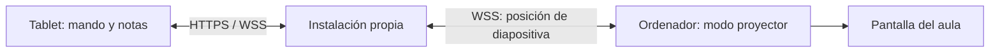

# Zona ponente

Presentaciones con un mando táctil para tablet, notas privadas y un proyector
sincronizado. Pensado para quien necesita leer, subrayar y completar sus notas
mientras imparte una formación.

HTML, CSS y JavaScript sin framework. Utiliza [Reveal.js](https://revealjs.com/)
para las diapositivas, [StatiCrypt](https://github.com/robinmoisson/staticrypt)
para proteger las páginas y un pequeño servidor Node.js para sincronizar.

## Qué puedes hacer

- Avanzar las diapositivas desde el iPad, otra tablet o un ordenador.
- Ver las notas en el mando y las diapositivas en el proyector.
- Arrastrar la barra naranja para repartir el espacio entre notas y diapositiva.
  Recuerda el ajuste por dispositivo y orientación; un doble toque lo restablece.
- Cambiar el tamaño del texto, subrayar y añadir una nota propia por diapositiva.
- Recuperar tus anotaciones en otro dispositivo mediante sincronización cifrada.
- Conservar las notas localmente cuando se interrumpe la conexión.

El repositorio incluye exclusivamente código, configuración de ejemplo y una
presentación ficticia. Cada instalación genera sus propias credenciales.

## Probar en tu ordenador

Necesitas Node.js **20.6 o superior**, npm y Python **3.10 o superior**.

```bash
git clone https://github.com/sasogu/zona-ponente.git
cd zona-ponente
npm ci
python3 scripts/configurar.py
npm run build
npm start
```

Abre **http://localhost:8110**, introduce la contraseña que acabas de elegir y
abre los enlaces **Mando con notas** y **Proyector sincronizado** en dos ventanas.
También puedes acceder directamente a:

- Mando: `http://localhost:8110/ponente/demo/?mando=1`
- Proyector: `http://localhost:8110/ponente/demo/?pantalla=1`

La demo no depende de una CDN: los recursos de Reveal.js se sirven desde la
instalación local. El cifrado y el relé requieren el servidor; abrir los archivos
con `file://` no sirve.

## Usarlo con un iPad y un proyector

Para dos dispositivos, publica tu instalación bajo **HTTPS**, con el mismo
dominio para la web y `/sync/`. El mando se abre en la tablet y el proyector en el
navegador del ordenador conectado a la pantalla. [Guía de despliegue](docs/despliegue.md).



**Duplicar por HDMI o AirPlay la pantalla que contiene las notas también muestra
las notas al público.** Este proyecto utiliza dos vistas de navegador; no controla
por separado la salida HDMI del iPad ni transmite imagen o vídeo por WebSocket.

En el mando:

- Arrastra el separador naranja con el dedo o el ratón.
- Pulsa **A− / A+** para cambiar la letra.
- Selecciona texto y toca el rotulador para subrayar; toca una marca para borrarla.
- Usa **+ Añadir mi nota** y **Hecho** para guardar un recordatorio.
- La nube indica si tus anotaciones están sincronizadas o pendientes.
- Si Safari permite pantalla completa, utiliza su botón. Añadir la web a la
  pantalla de inicio es otra opción para aprovechar el espacio.

## Añadir tus presentaciones

```bash
cp presentaciones.example.json presentaciones.json
mkdir -p private
```

Guarda tus HTML de Reveal.js en `private/` y adapta el manifiesto:

```json
{
  "title": "Mis presentaciones",
  "decks": [
    { "title": "Mi formación", "source": "private/formacion.html", "slug": "formacion" }
  ]
}
```

El HTML debe inicializar Reveal.js, cargar el plugin de notas e incluir las notas
como `<aside class="notes">…</aside>`. Usa `examples/demo.html` como plantilla y
mantén las referencias a `/vendor/reveal/`. Esta primera versión admite HTML
autocontenido; no copia carpetas de recursos privados automáticamente. Para
imágenes, puedes incorporarlas como datos dentro del HTML o usar recursos que
hayas publicado expresamente.

Ejecuta `npm run build` tras los cambios y publica únicamente `dist/` como parte
de tu instalación. **No subas tus presentaciones, aunque estén cifradas, a este
repositorio público.** El índice y cada deck se cifran antes de generar la salida.

Conserva el `slug` de cada presentación: identifica sus anotaciones. Si cambias el
orden de las diapositivas, las notas propias siguen asociadas a su índice; revisa
que no hayan quedado vinculadas a una diapositiva diferente.

## Configuración y privacidad

El asistente crea `.env` con permisos `0600`. No imprime contraseñas ni claves.
El archivo, los manifiestos privados, las fuentes en `private/`, la salida
`dist/`, el estado `data/` y `.staticrypt.json` están excluidos de Git.

| Variable | Función |
| --- | --- |
| `STATICRYPT_PASSWORD` | Contraseña para abrir las páginas |
| `SYNC_AUTH_SECRET` | Clave propia del relé, de 32 bytes hexadecimales |
| `HOST` / `PORT` | Interfaz y puerto de escucha; por defecto loopback y 8110 |
| `ALLOWED_ORIGINS` | Orígenes exactos autorizados, separados por comas |
| `PUBLIC_DIR` / `DATA_DIR` | Carpetas opcionales para la salida y el estado |

El navegador cifra las anotaciones con AES-GCM antes de enviarlas. El relé guarda
el bloque cifrado y conserva hasta 20 revisiones anteriores. HTTP y WebSocket
exigen credenciales del canal; los orígenes también se comprueban. Las anotaciones
del navegador se almacenan localmente en claro para poder trabajar sin conexión.

Todos los dispositivos con la contraseña de una instalación comparten las
presentaciones y sus anotaciones. No es un sistema multiusuario con permisos
individuales. La protección de las páginas depende de una contraseña larga y
única; evita que terceros ejecuten código en tu mismo dominio.

Conserva `.env`, `.staticrypt.json` y `data/` en una copia privada. Cambiar la
contraseña cambia los canales y las claves de las anotaciones. No hay una migración
automática de datos al cambiar las credenciales. [Detalles de seguridad](SECURITY.md).

## Pruebas

```bash
npm test
python3 -m venv .venv
.venv/bin/pip install -r requirements-dev.txt
.venv/bin/python -m playwright install chromium webkit
PATH="$PWD/.venv/bin:$PATH" npm run test:browser
```

Las pruebas usan datos ficticios y servidores temporales: comprueban cifrado,
autenticación, revisiones concurrentes, permisos de archivos, aislamiento de
carpetas, mando/proyector, notas, subrayados, arrastre táctil, giro y persistencia.
WebKit cubre el motor de Safari; también conviene verificar en un iPad real.

`npm run check:public` revisa los archivos incluidos en Git sin imprimir los
posibles valores sensibles. Es una comprobación adicional, no sustituye revisar
los archivos antes de publicarlos.

## Estructura

```text
web/sync.js                 Mando, notas y cliente de sincronización
server/server.js            Relé, API cifrada y servidor de dist/
scripts/configurar.py       Credenciales de una instalación nueva
scripts/generar.py          Generación y cifrado de presentaciones
scripts/check_public.py     Comprobación de archivos públicos
examples/demo.html          Presentación ficticia
tests/                     Pruebas de servidor y navegadores
deploy/                    Plantillas genéricas de despliegue
```

Licencia **MIT**. Reveal.js, StatiCrypt y ws conservan sus respectivas licencias.
