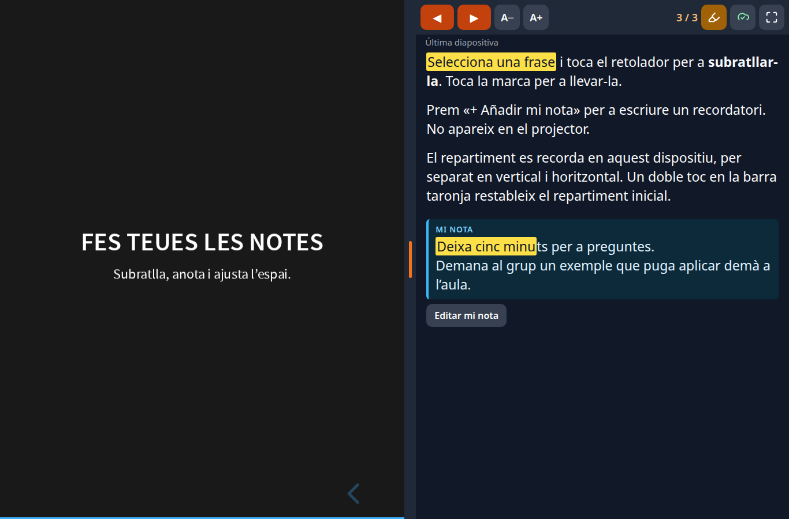
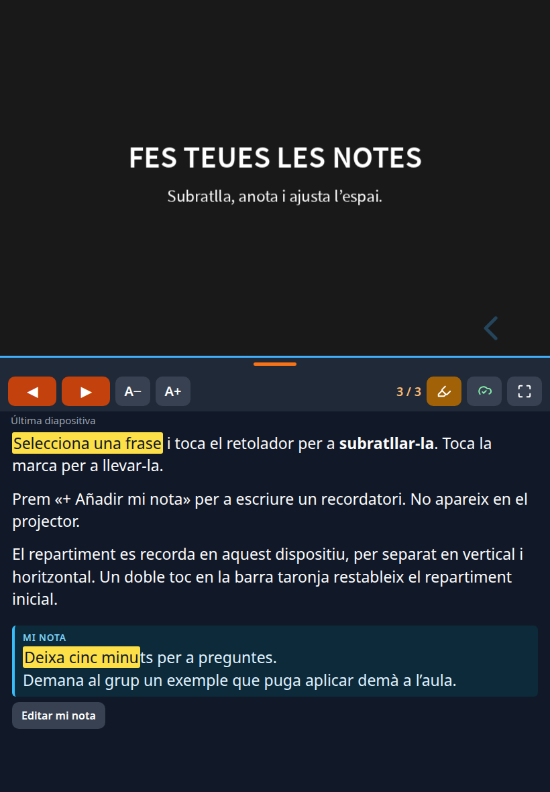
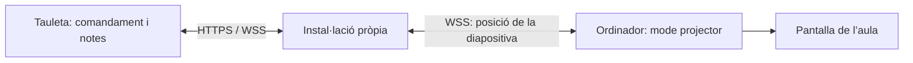

# Zona ponent

Presentacions amb un comandament tàctil per a tauleta, notes privades i un projector
sincronitzat. Pensat per a qui necessita llegir, subratllar i completar les seues
notes mentre imparteix una formació.

HTML, CSS i JavaScript sense framework. Utilitza [Reveal.js](https://revealjs.com/)
per a les diapositives, [StatiCrypt](https://github.com/robinmoisson/staticrypt)
per a protegir les pàgines i un servidor Node.js menut per a sincronitzar-les.

## Què pots fer

- Avançar les diapositives des de l’iPad, una altra tauleta o un ordinador.
- Veure les notes en el comandament i les diapositives en el projector.
- Arrossegar la barra taronja per a repartir l’espai entre notes i diapositiva.
  Recorda l’ajust per dispositiu i orientació; un doble toc el restableix.
- Canviar la grandària del text, subratllar i afegir una nota pròpia per diapositiva.
- Recuperar les teues anotacions en un altre dispositiu mitjançant sincronització xifrada.
- Conservar les notes localment quan s’interromp la connexió.

El repositori inclou exclusivament codi, configuració d’exemple i una presentació
fictícia. Cada instal·lació genera les seues pròpies credencials.

## Zona de notes

El comandament combina la diapositiva actual amb un espai de lectura i anotació
que pots adaptar mentre presentes.

| Funció | Què et permet fer |
| --- | --- |
| **Espai ajustable** | Arrossegar la barra taronja per a donar més espai a les notes o a la diapositiva. L’ajust es recorda per separat en vertical i horitzontal. |
| **Text més llegible** | Fer la lletra més gran o més menuda amb **A− / A+**, amb la grandària recordada en el dispositiu. |
| **Subratllats** | Seleccionar text i marcar-lo amb el retolador, tant en les notes originals com en les notes pròpies guardades. Tocar una marca la lleva. |
| **Notes pròpies** | Afegir un recordatori a cada diapositiva, editar-lo o esborrar-lo. Es mostra en un requadre separat i no en la vista del projector. |
| **Sincronització xifrada** | Recuperar les anotacions en un altre dispositiu de la mateixa instal·lació. El núvol indica l’estat de sincronització. |
| **Guardat local** | Conservar les anotacions en el navegador si es perd la connexió i sincronitzar-les quan torne. |
| **Navegació a mà** | Avançar o retrocedir amb els botons del comandament i consultar el comptador i el títol de la diapositiva següent. |

### Captures de la demostració

Les captures utilitzen únicament contingut fictici en valencià. Les etiquetes dels
botons corresponen a la interfície actual, en castellà.

**En horitzontal:** diapositiva a l’esquerra, notes a la dreta, text subratllat i un
recordatori propi guardat.



**En vertical:** diapositiva damunt i notes davall. Pots moure el separador per a
ajustar l’espai a la teua manera de llegir.



## Provar-lo en el teu ordinador

Necessites Node.js **20.6 o superior**, npm i Python **3.10 o superior**.

```bash
git clone https://github.com/sasogu/zona-ponent.git
cd zona-ponent
npm ci
python3 scripts/configurar.py
npm run build
npm start
```

Obri **http://localhost:8110**, introdueix la contrasenya que acabes de triar i
obri els enllaços **«Mando con notas»** i **«Proyector sincronizado»** en dues
finestres. La interfície manté aquestes etiquetes en castellà.
També pots accedir directament a:

- Comandament: `http://localhost:8110/ponente/demo/?mando=1`
- Projector: `http://localhost:8110/ponente/demo/?pantalla=1`

La demostració no depén d’una CDN: els recursos de Reveal.js se serveixen des de
la instal·lació local. El xifrat i el servei de sincronització requereixen el
servidor; obrir els fitxers amb `file://` no serveix.

## Usar-lo amb un iPad i un projector

Per a dos dispositius, publica la teua instal·lació amb **HTTPS**, amb el mateix
domini per a la web i `/sync/`. El comandament s’obri en la tauleta i el projector,
en el navegador de l’ordinador connectat a la pantalla.
[Guia de desplegament](docs/despliegue.md).



**Duplicar per HDMI o AirPlay la pantalla que conté les notes també mostra les
notes al públic.** Aquest projecte utilitza dues vistes de navegador; no controla
per separat l’eixida HDMI de l’iPad ni transmet imatge o vídeo per WebSocket.

En el comandament:

- Arrossega el separador taronja amb el dit o el ratolí.
- Prem **A− / A+** per a canviar la lletra.
- Selecciona text i toca el retolador per a subratllar; toca una marca per a esborrar-la.
- Usa **«+ Añadir mi nota»** i **«Hecho»** per a guardar un recordatori.
- El núvol indica si les teues anotacions estan sincronitzades o pendents.
- Si Safari permet la pantalla completa, utilitza el seu botó. Afegir la web a la
  pantalla d’inici és una altra opció per a aprofitar l’espai.

## Afegir les teues presentacions

```bash
cp presentaciones.example.json presentaciones.json
mkdir -p private
```

Guarda els teus HTML de Reveal.js en `private/` i adapta el manifest:

```json
{
  "title": "Les meues presentacions",
  "decks": [
    { "title": "La meua formació", "source": "private/formacion.html", "slug": "formacion" }
  ]
}
```

L’HTML ha d’inicialitzar Reveal.js, carregar el connector de notes i incloure les
notes com a `<aside class="notes">…</aside>`. Usa `examples/demo.html` com a
plantilla i mantín les referències a `/vendor/reveal/`. Aquesta primera versió
admet HTML autocontingut; no copia carpetes de recursos privats automàticament.
Per a les imatges, pots incorporar-les com a dades dins de l’HTML o usar recursos
que hages publicat expressament.

Executa `npm run build` després dels canvis i publica únicament `dist/` com a
part de la teua instal·lació. **No puges les teues presentacions, encara que
estiguen xifrades, a aquest repositori públic.** L’índex i cada presentació es
xifren abans de generar l’eixida.

Conserva el `slug` de cada presentació: identifica les seues anotacions. Si canvies
l’ordre de les diapositives, les notes pròpies continuen associades al seu índex;
revisa que no hagen quedat vinculades a una diapositiva diferent.

## Configuració i privacitat

L’assistent crea `.env` amb permisos `0600`. No imprimeix contrasenyes ni claus.
El fitxer, els manifests privats, les fonts en `private/`, l’eixida `dist/`,
l’estat `data/` i `.staticrypt.json` estan exclosos de Git.

| Variable | Funció |
| --- | --- |
| `STATICRYPT_PASSWORD` | Contrasenya per a obrir les pàgines |
| `SYNC_AUTH_SECRET` | Clau pròpia del servei de sincronització, de 32 bytes hexadecimals |
| `HOST` / `PORT` | Interfície i port d’escolta; per defecte, loopback i 8110 |
| `ALLOWED_ORIGINS` | Orígens exactes autoritzats, separats per comes |
| `PUBLIC_DIR` / `DATA_DIR` | Carpetes opcionals per a l’eixida i l’estat |

El navegador xifra les anotacions amb AES-GCM abans d’enviar-les. El servei de
sincronització guarda el bloc xifrat i conserva fins a 20 revisions anteriors.
HTTP i WebSocket exigeixen credencials del canal; els orígens també es comproven.
Les anotacions del navegador s’emmagatzemen localment en clar per a poder
treballar sense connexió.

Tots els dispositius amb la contrasenya d’una instal·lació comparteixen les
presentacions i les seues anotacions. No és un sistema multiusuari amb permisos
individuals. La protecció de les pàgines depén d’una contrasenya llarga i única;
evita que tercers executen codi en el teu mateix domini.

Conserva `.env`, `.staticrypt.json` i `data/` en una còpia privada. Canviar la
contrasenya canvia els canals i les claus de les anotacions. No hi ha una migració
automàtica de dades quan es canvien les credencials.
[Detalls de seguretat](SECURITY.md).

## Proves

```bash
npm test
python3 -m venv .venv
.venv/bin/pip install -r requirements-dev.txt
.venv/bin/python -m playwright install chromium webkit
PATH="$PWD/.venv/bin:$PATH" npm run test:browser
```

Les proves usen dades fictícies i servidors temporals: comproven el xifrat,
l’autenticació, les revisions concurrents, els permisos dels fitxers, l’aïllament
de carpetes, el comandament/projector, les notes, els subratllats, l’arrossegament
tàctil, el gir i la persistència. WebKit cobreix el motor de Safari; també convé
verificar-ho en un iPad real.

`npm run check:public` revisa els fitxers inclosos en Git sense imprimir els
possibles valors sensibles. És una comprovació addicional; no substitueix la
revisió dels fitxers abans de publicar-los.

## Estructura

```text
web/sync.js                 Comandament, notes i client de sincronització
server/server.js            Servei de sincronització, API xifrada i servidor de dist/
scripts/configurar.py       Credencials d’una instal·lació nova
scripts/generar.py          Generació i xifrat de presentacions
scripts/check_public.py     Comprovació dels fitxers públics
examples/demo.html          Presentació fictícia
tests/                     Proves de servidor i navegadors
deploy/                    Plantilles genèriques de desplegament
```

Llicència **MIT**. Reveal.js, StatiCrypt i ws conserven les seues respectives llicències.
